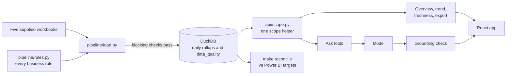

# Write-up

This is for whoever picks the Attractions app up next. It covers what was
built and why, what was wrong in the data, how the numbers are checked,
what leaves the system, and what was cut. The details behind each claim are
in the docs it links to.

## What I built and why

The Power BI report was slow, went stale without saying so, and nobody
could tell whether its numbers were right. So the order of work was the data first, then a reconciliation against the
report, then the API with venue scope, then the Overview page, and last one
AI feature.

The load reads the five workbooks, applies the rules in `pipeline/rules.py`
and writes daily rollups by venue, department, package class and channel.
It writes to a temporary file and swaps it in only when every blocking
check passes, so a bad load leaves yesterday's numbers in place. Each check is a row in a `data_quality` table, so the latest successful
load records what it dropped and why. A failed load reports only to the
console, and earlier runs are not kept. The rules live in one module with a unit test each, and neither
the API nor the frontend repeats them.

The API is FastAPI. Every route, the CSV export and the AI tools included,
gets its venues from one helper that intersects the request with the
user's scope. A venue outside it is a 403, never an empty result. The
frontend is React and Vite with the brand fonts and logos as supplied. DuckDB
was enough for three venues and one container.

At 200 venues the rules and the scope helper would stay as they are. The
rest changes. The workbooks become feeds loaded per venue on a schedule,
and a failed check blocks only that venue's load. DuckDB becomes
Azure SQL or Postgres, since many writers and many readers need a server.
The mapping tables for messy labels become reference data that operations
maintains, with an alert when a new spelling arrives. Scope comes from
Entra groups mapped to venue lists in a table, which also gives Dana's
portfolio sales role (see the backlog). Reconciliation targets come from
Finance each week instead of a fixture.

## Data issues

All fixes are rules applied at load. The workbooks are never edited.
DATA_ISSUES.md has the full table and DATA_PROFILE.md the evidence. Impact
is on Summit for 2026-09-28 to 2026-10-04.

| What | How it was found | Fix | Effect on the week |
|---|---|---|---|
| Ticket lines loaded twice | `ticket_line_id` repeats with a later `ingestion_ts` | Keep the latest load, and stop if copies disagree | None (262 rows, all in June) |
| Cancelled lines keep their quantity and value. LT and NT spell status differently | `record_status` is ACTIVE on every row | A per-source list of cancelled statuses. An unknown status stops the load | 80 guests and $1,945 removed |
| Add-ons and event entries in the ticket feed | `dim_package` class | Excluded from attendance and ticket revenue | 112 guests and $1,330 removed |
| NT `event_time` is UTC | Raw hours run 13 to 3 | Use `event_date`, and warn if the converted time disagrees | None. The raw UTC date would cost 1 guest and $160 |
| POS order totals repeat on every line | One total per order | Revenue from lines, net of discount, voids out | Not measured. Summing per-line totals would overstate F&B and merch |
| POS rows that look like duplicates are real | Subtotals only match with them kept | Never deduplicate POS | Dropping them would remove $418 |
| Messy labor labels | 24 department labels, 12 location spellings | Mapping tables. An unmapped value stops the load | Department split only |
| Shifts with no rate | Null rate and earnings | Payroll marked incomplete, no estimate | 2 shifts and 13 hours unpaid, about $267 |
| Multi-day bookings repeat the booking total | Booking total equals the sum of events | Event-level money on the event date, Definite only | None this week |
| Riverbend 2026-04-18 has no tickets or POS | Feed coverage gap with labor present | "No data", never zero | None |
| After-midnight sales | 431 POS rows before 04:00 | 4 AM business-day cutoff | None at Summit. Riverbend needs it to match |

## The hard parts

The hardest call was F&B. The 9,230 target is Restaurant, Bar and Cafe, but
the report's Ancillary visual shows about $8.0K, because it subtracts Bar <!-- numbers: ok, a Power BI display figure -->
from Restaurant and then shows Bar again. I first asked for the visual to be
reproduced as is. Claude pushed back, citing the packet's instruction to
say when a Power BI number is wrong, and I agreed. The app shows the
correct F&B and RECONCILIATION.md (R-002) shows the rows that make up the
gap. That conclusion is inferred from the arithmetic, since we have no
.pbix file.

Two smaller gaps were kept rather than forced to match. Riverbend's total
is $1 under the target because Power BI adds rounded components. We round
once, since a total that changes with its parts' display precision gets
worse as venues are summed (R-001). Productivity shows 3.82 where Power BI
shows 3.81, probably because it rounds each shift's hours first. The hours
target matches the unrounded sum, so we kept that (R-004).

Other decisions had costs. Payroll with missing rates is marked incomplete
instead of estimated (D-006). The package class and channel filters apply only
to ticket metrics, and the tiles they do not affect are labelled, because
POS and labor have no package or channel (D-010). Date presets end
yesterday, so a partial day never looks like a dip (D-011). A comparison
over missing days shows no delta colour at all (D-012).

For Ask the data, the model never writes a number on its own. Tools return
the figures, and code rejects any reply containing a number that is not in
the tool output. A rejected reply falls back to a plain table. What I gave
up is a check on meaning. The check matches values only, so "attendance
was 91,891" would pass if 91,891 is the comparison revenue. The page says
this and shows the table under every answer (D-015).

## How we know the numbers are right

The numbers are checked in four ways. The 285 tests include a unit test with a small synthetic
fixture for every rule. The load runs blocking checks on the real data on
every run, such as POS subtotals matching their lines and duplicate loads
agreeing. `make reconcile` compares the week with the Power BI targets in
`tests/fixtures/pbi_targets.json`. 23 of 24 targets match, all eight for
Summit, and the one miss is R-001. A slow test checks Summit's week through the API as well, so a change that
moves the page's Summit numbers away from the reconciliation fails that
test locally.
`make numbers` checks that every decimal and percentage in these docs
appears in a generated report.

Ask the data has its own eval of seven cases in `evals/cases.yaml`: a
last-year comparison, labor, pace to plan, another venue as Marcus (must
be a 403), a question the data cannot answer, a prompt injection and a
missing day. 6 of 7 pass on the recorded Opus 5.5 answers. The failure, <!-- numbers: ok, a model version -->
`missing_day`, is the eval being too strict. The answer correctly says
there is no data and that it "shouldn't be read as zero visitors", but the
case forbids the word "zero". I left it failing. The check needs fixing, and the expected answer stays
as written.

CI runs `make ci` (lint, types, tests and style) on pull requests and
pushes to main, and the first run on GitHub passed. The supplied data is not
in git, so CI cannot run the real-data test, the reconciliation, the evals
or `make numbers`. Those run locally, and the last of them in the gate
before every agent turn ends. In production the same reconciliation would run after each nightly load
against figures Finance signs off, and a miss would block the swap and
alert the owner instead of publishing.

## Security

Sign-in is meant to be Entra ID through App Service authentication, which
passes the user in the `X-MS-CLIENT-PRINCIPAL` header. That parse is not
built. Today the user comes from `DEV_USER` or an `X-Dev-User` header,
which anyone can set, so that path must be removed before this goes
anywhere near production. Venue scope is enforced on the server in one
helper, and every route has a test as `marcus@dev`, including the export
and Ask. Asking for a venue outside your scope, by URL or query parameter, gives a
403.

Secrets live in `.env`, which is gitignored and excluded from Docker
images. In Azure the API key would be a Key Vault reference in the App
Service settings, read through a managed identity.

The model gets the user's question, a fixed system prompt and the tool
outputs, which are aggregates such as revenue by department for a venue
and week. Guest fields (country, order ids, person ids) and free-text
fields (comments, notes, void and lost reasons) are never loaded into the
database (D-009), so no tool can return them. The venue comes from the
user's scope and is never a model argument, so injected text cannot change which venue is queried. One eval case tests
this. The recorded run
measured $0.0192 per question, about $77 a day at 200 venues and 20
questions each, before prompt caching (D-016). Ben's other questions,
where requests are processed and whether they are retained, depend on the
contract. I would ask Anthropic for zero data retention, and find out from
Ben whether a model hosted through Azure is required instead.

Deployment would be App Service for Containers with a staging slot.
Deploy to staging, run the smoke test (Summit's week matches the targets,
Marcus gets a 403 on Riverbend, freshness is current), then swap.
Rollback is swapping back. That rolls back code, not data. The nightly
load would run as a scheduled Container Apps job that writes the database
file to Azure Files, which the API mounts read-only. Each load writes a new
file and keeps the previous one, so a bad load is rolled back by pointing
the API at yesterday's file. At 200 venues this becomes the managed
database described above, with its own point-in-time restore.

## AI log and reflection

I built this with Claude Code. I wrote the plan and the project rules and reviewed each diff. docs/AI_LOG.md has the phase-by-phase record, mistakes included.

It helped most where the work was wide and checkable. Profiling five
workbooks in parallel, testing eleven hypotheses about the data and working
out that the Ancillary visual subtracts Bar from Restaurant and then shows
it again took about 20 minutes. It
wrote the tests, the Docker setup and the first drafts of these docs, and a reviewer agent found bugs at the end of each phase (see AI_LOG).

It was wrong in ways that matter. During profiling its scripts printed
guest order ids, country counts and a void reason into model context,
because I had not put the guest data rule into the subagent prompts. That
is fixed in the scripts and the project rules now, but the data had already
been read. It once marked its own derived numbers with the tag meant for
Power BI display figures, which made the docs check pass on numbers with no
source. It left private events out of total revenue, which only the
real-data check caught. It declared the frontend tests passing when two of
them would have passed with the feature broken. Its first grounding check
passed its own tests but let signed figures through. The pattern was the
same each time. Tests it wrote after the code agreed with the code. What
caught the bugs was reconciliation against real targets, the reviewer
agent, and breaking the code on purpose to see if a test failed.

One thing I would never let it do unattended is decide which number is
right. When our figure and Power BI's disagree, the easy fixes are to edit
the target, loosen the test or tweak a rule until they match. Each of those hides the disagreement Finance needs to see.

## What I cut and what is next

- Entra sign-in, and removing the dev user header.
- A metric-level grounding check that ties each number to its label.
- The `missing_day` eval case fails on the word "zero" in a correct
  answer. Changing its forbidden-phrase check is an eval design change for
  Nick to decide.
- The other tabs (Ticketing, F&B, Merchandise, Events, Pacing Report,
  Cost Watch, Support, Settings). They are routes that keep the filters.
- The load health page and the overtime flag, first in the backlog.
- Weather on the attendance chart, which was optional.
- A dev user switcher in the UI, and the trend's grain in the URL.
- Upgrading Vite and React Router to clear dev-only audit findings (D-014).
